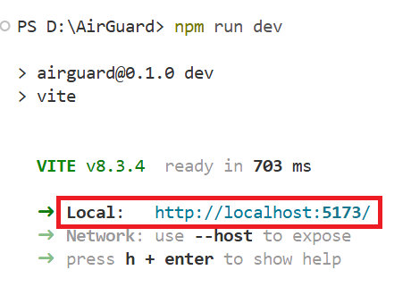
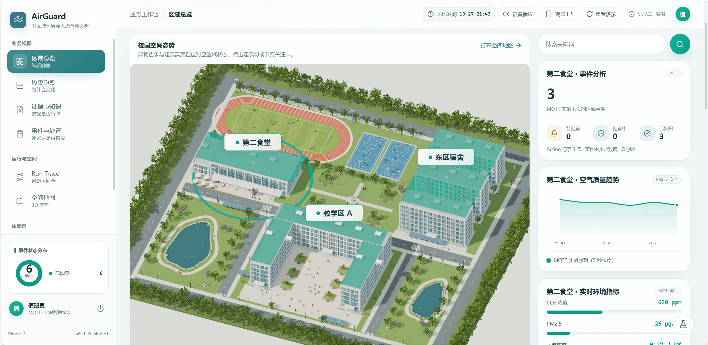
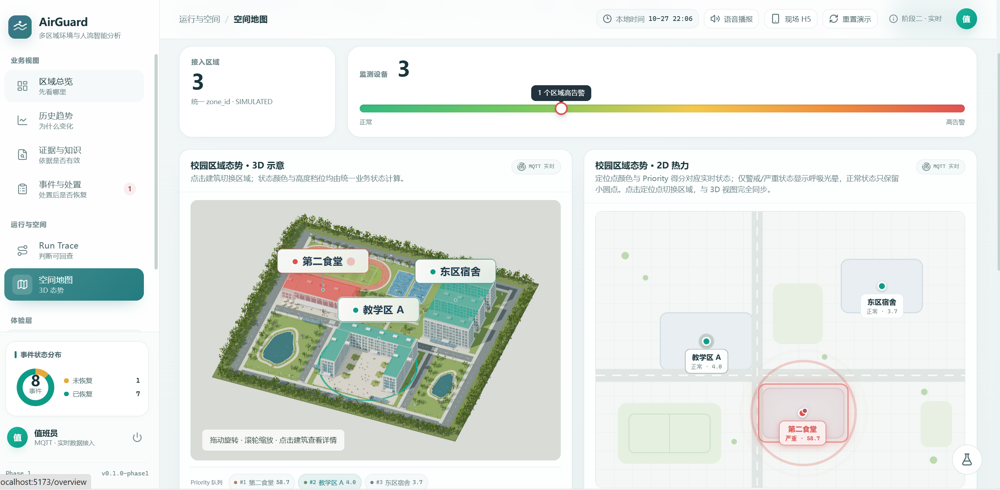
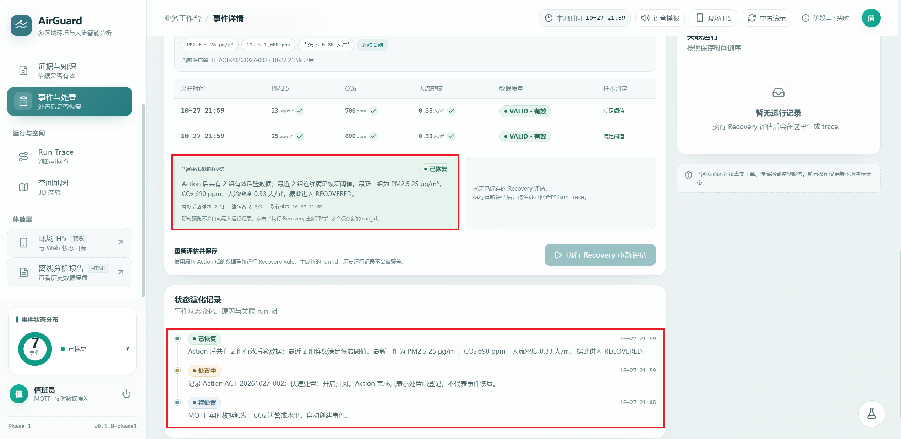
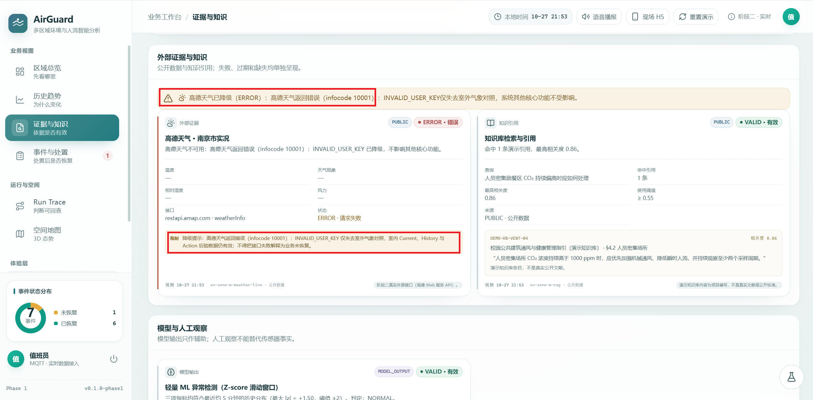
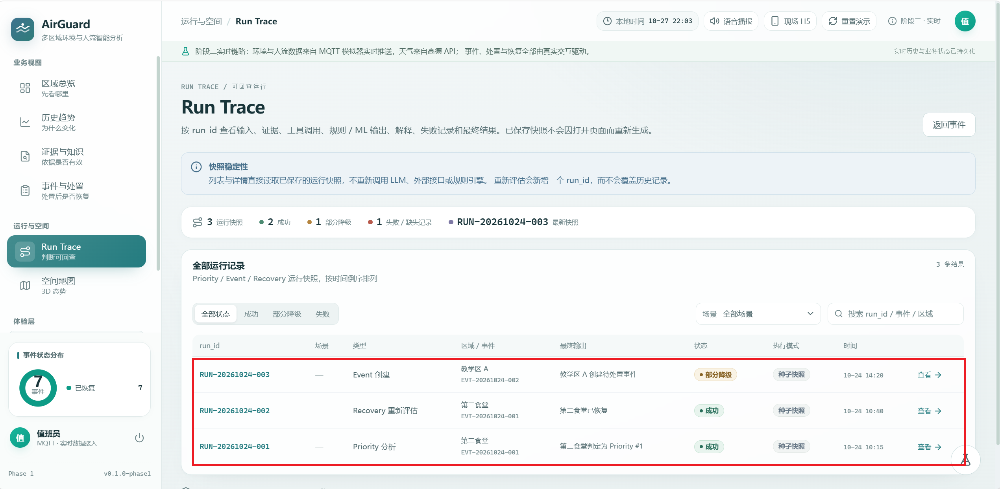
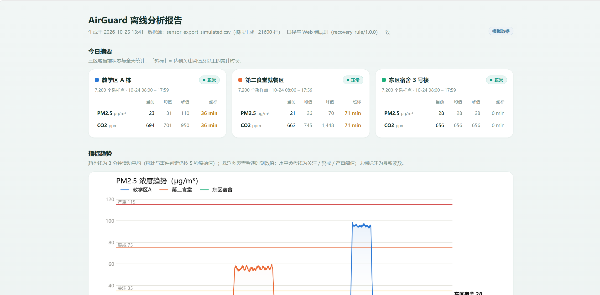

# AirGuard · 多区域环境与人流智能分析系统

> 看清区域风险，追踪处置是否真正改善。

AirGuard 是基于 React、Vite、TypeScript、MQTT 与 Three.js 的校园多区域环境和人流监测工作台。系统围绕宿舍、教学区和食堂展示指标、Priority、事件与处置后验证过程，并提供 Web 工作台、H5 现场端、3D/2D 空间示意和 Python CSV 离线报告。

> **数据边界：** 当前 MQTT 观测值由 `simulator.js` 生成，不代表真实校园传感器结果；地图是校园空间示意，不使用真实地理坐标。环境指标与项目内阈值只用于教学和竞赛演示，不构成健康或公共卫生诊断。

## 1. 它解决什么问题

| 项      | 内容                                                                       |
| ------ | ------------------------------------------------------------------------ |
| 给谁用    | 校园值班人员、运维人员与现场巡检人员。                                                      |
| 在什么场景  | 宿舍、教学区和食堂出现环境指标或人流变化时，需要查看多区域状态、判断先关注哪个区域，并跟踪处置后的变化。                     |
| 解决什么   | 将多区域指标、趋势和事件放在同一工作台，展示关注优先级及其因素，并使用处置后的新样本评估是否恢复，避免只看单一读数或把“已处置”当作“已恢复”。 |
| 明确不做什么 | 不提供医疗诊断或公共卫生结论；不自动控制新风、喷雾等物理设备；当前不接入真实传感器；地图不表示真实地理坐标。                   |

## 2. 核心功能

| 功能                        | 当前状态 | 一句话说明                                                                              |
| ------------------------- | ---- | ---------------------------------------------------------------------------------- |
| MQTT 多区域实时数据              | 部分实现 | 浏览器通过 MQTT 接收区域数据；当前观测值由 `simulator.js` 生成，并非真实传感器读数。                              |
| 可解释 Priority              | 已实现  | 当前 PM2.5、CO₂、人流密度、历史趋势、持续时间和未关闭事件参与区域关注排序，并展示因子贡献。                                 |
| Event → Action → Recovery | 已实现  | Action 记录后使用其后的新样本判断 Recovery；Action 完成不等于 Recovery。                               |
| Web、H5 与空间地图              | 已实现  | 提供总览、历史、证据、事件、运行记录、3D/2D 示意地图和 H5 现场端。                                             |
| 固定规则与 Z-score 对照          | 部分实现 | 固定阈值与浏览器端 Z-score 滑动窗口统计并列展示；Z-score 是辅助统计，不包含模型训练、模型文件保存与重载流程。                    |
| 高德天气外部证据                  | 部分实现 | 可请求南京市实况天气；Key 缺失、网络失败或请求超时会显示降级状态，不用天气结果改写室内业务事实。                                 |
| Python CSV 离线报告           | 已实现  | `analyze_report.py` 读取 CSV 并生成 `report.html`；缺少输入 CSV 时会生成模拟数据。离线分析不会自动导出 MQTT 历史。 |
| 在线 RAG 与服务端持久化            | 未实现  | 知识引用目前是静态演示条目；事件、Action、运行记录及实时历史保存在浏览器 `localStorage`，不是服务端数据库。                   |

## 3. 10 分钟快速复现

下列复现记录由参赛者提供：Windows 11、16 GB 内存、AMD Ryzen 处理器；首次安装；日期为 2026-10-27；记录总耗时 3 分 15 秒，按概述口径约 4 分钟。详细设备型号和 Node.js 实际输出未出现在记录中。

### 路线 A：完整模式（连接外部服务）

需要 Node.js、npm、npm 依赖安装网络、可用 MQTT Broker；天气功能还需要有效的高德 Web 服务 Key。仓库默认使用公共 EMQX Broker，不要通过该公共服务传输个人信息或敏感照片。

在 Bash / Git Bash 终端执行：

```bash
git clone https://github.com/Bao-Jie812/AirGuard.git
cd AirGuard
npm ci
if [ ! -f .env ]; then cp .env.example .env; fi
```

如需天气功能，在项目根目录编辑 `.env`，为 `VITE_AMAP_KEY` 填入自己申请的高德 Web 服务 Key。仅运行无 Key 降级模式时，可以不创建 `.env`。

在终端 A（项目根目录）启动前端：

```bash
npm run dev -- --host 127.0.0.1
```

在终端 B（项目根目录）启动模拟器：

```bash
node simulator.js
```

### 前端检查与生产构建

```bash
npm run typecheck
npm run lint
npm run build
npm run preview
```

`npm run preview` 用于预览已生成的 `dist/` 构建产物；执行前应先运行 `npm run build`。

打开浏览器：

- Web 工作台：<http://localhost:5173/overview>
- H5 现场端：<http://localhost:5173/m>

**期望结果：** Vite 显示本地服务地址；模拟器连接成功后输出 `connected to mqtt://broker.emqx.io:1883`，随后每 5 秒向三个区域发布 JSON。Web 与 H5 的区域读数、趋势和空间状态随演示数据更新。天气实况需有效 Key 与外网连接。

### 路线 B：无天气密钥 / 外部服务不可用时

这条路线验证天气 Key 缺失或 MQTT Broker 不可用时前端仍可打开。它要求 npm 依赖已安装；全新机器在完全离线且没有 `node_modules` 或 npm 缓存时，`npm ci` 无法完成依赖安装。本项目没有离线 npm 依赖包。

在项目根目录启动前端，不创建 `.env`，也不启动模拟器：

```bash
npm run dev -- --host 127.0.0.1
```

打开 <http://localhost:5173/overview>。

**降级后的能力：** 未设置 `VITE_AMAP_KEY` 时，天气证据显示 `ERROR` 并说明未配置 Key；Broker 不可用时，MQTT 状态显示连接中、重连中或离线。前端页面与本地种子事件、运行记录仍可打开，但实时读数、模拟器联动和依赖 MQTT 新样本的完整异常处置流程不可用。

> **若未配置，系统将触发降级机制，不影响核心业务。** 这里的核心业务指不依赖天气的页面展示、规则/Priority 逻辑和本地事件流程；若 MQTT 服务不可用，实时数据与跨端联动本身不可运行。

### 本次冷启动记录

| 步骤        | 命令 / 操作                                                         | 记录耗时     | 记录结果                     |
| --------- | --------------------------------------------------------------- | -------- | ------------------------ |
| 1. 拉取源码   | `git clone https://github.com/Bao-Jie812/AirGuard.git`          | 20 秒     | 网络通畅，拉取成功。               |
| 2. 安装依赖   | `npm install`                                                   | 2 分 10 秒 | 安装 Three.js 等前端依赖。       |
| 3. 配置环境变量 | 复制 `.env.example` 为 `.env` 并填写 Key                              | 15 秒     | 完整模式；天气 Key 已填写。         |
| 4. 初始化数据  | 启动模拟器并检查初始化                                                     | 5 秒      | 模拟器启动时初始化内存状态。           |
| 5. 启动服务   | 终端 A `npm run dev -- --host 127.0.0.1`；终端 B `node simulator.js` | 15 秒     | 两个进程正常运行，Web 显示 MQTT 在线。 |
| 6. 打开页面   | 访问 `http://localhost:5173/overview`                             | 10 秒     | 首屏正常；记录中天气请求成功。          |

## 4. 环境与依赖

| 软件      | 要求版本                                   | 检查命令               | 本次记录的实测版本                    |
| ------- | -------------------------------------- | ------------------ | ---------------------------- |
| Node.js | Vite 8.3.4 要求 `^20.19.0` 或 `>=22.12.0` | `node --version`   | v24.21.0                     |
| npm     | 随 Node.js 安装；项目有 `package-lock.json`   | `npm --version`    | 11.19.0                      |
| Python  | Python 3，用于可选离线报告                      | `python --version` | 3.12.10                      |
| 浏览器     | 当前没有公布经过验证的浏览器支持矩阵                     | 浏览器设置中的“关于”页面      | Microsoft Edge 156.0.4314.42 |

前端依赖清单见 `package.json`，锁文件为 `package-lock.json`，推荐使用 `npm ci` 安装。Vite 版本要求来自 Vite 8.3.4 的 `engines` 声明。

Python 报告依赖 `numpy`、`pandas` 和 `matplotlib`。Python 报告依赖见 `requirements.txt`，可运行 `pip install -r requirements.txt` 安装。Windows Git Bash 下可运行：

```bash
python -m venv ../airguard-report-venv
../airguard-report-venv/Scripts/python.exe -m pip install numpy pandas matplotlib
../airguard-report-venv/Scripts/python.exe analyze_report.py
```

macOS / Linux Bash 下可运行：

```bash
python3 -m venv ../airguard-report-venv
../airguard-report-venv/bin/python -m pip install numpy pandas matplotlib
../airguard-report-venv/bin/python analyze_report.py
```

## 5. 环境变量

项目根目录提供 `.env.example`，其中列出可选变量 `VITE_AMAP_KEY`。该文件中的示例值不是有效凭据；启用天气功能时，应复制为 `.env` 并替换为自己的 Key。发布到 GitHub 前，应将 `.env.example` 纳入版本控制；真实 `.env` 已被 `.gitignore` 忽略，不要提交。

| 变量名             | 是否必填 | 作用                             | 不填会怎样                                                                              |
| --------------- | ---- | ------------------------------ | ---------------------------------------------------------------------------------- |
| `VITE_AMAP_KEY` | 可选   | 高德开放平台 Web 服务 Key，用于请求南京市实况天气。 | 天气证据显示 `ERROR` 并说明未配置 Key；MQTT、Priority 和事件处理不依赖天气 Key。**若未配置，系统将触发降级机制，不影响核心业务。** |

在 Bash / Git Bash 中，仅当 `.env` 不存在时复制示例：

```bash
if [ ! -f .env ]; then cp .env.example .env; fi
```

随后手动编辑 `.env`。若保留示例值，天气请求会返回 `ERROR`。修改 `.env` 后需要重启 Vite。`VITE_` 变量会进入浏览器端构建产物，不是服务端秘密；公开部署应按高德平台规则限制 Key，并评估通过后端代理请求。

## 6. 复现实测记录

| 项    | 本次记录                                                                       |
| ---- | -------------------------------------------------------------------------- |
| 测试人  | 本人                                                                         |
| 机器   | Windows 11，16 GB 内存，AMD Ryzen 处理器。                                         |
| 是否首次 | 是，记录为首次安装。                                                                 |
| 测试日期 | 2026-10-27                                                                 |
| 总耗时  | 记录总计 3 分 15 秒；概述口径约 4 分钟。                                                  |
| 环境版本 | npm 11.19.0、Python 3.12.10、Microsoft Edge 156.0.4314.42；Node.js 实际版本未写入记录。 |

## 7. 验收清单（跑起来该看到什么）

### 服务启动

操作：终端 A 运行 `npm run dev -- --host 127.0.0.1`，终端 B 运行 `node simulator.js`。  
期望：Vite 输出本地服务地址；模拟器连接 Broker 并周期发布数据；Web 显示 MQTT 在线。



### 首页总览

操作：打开 `/overview`。  
期望：看到区域总览、Priority、空间状态和证据健康信息。



### 触发异常

操作：在总览页点击「触发食堂异常」。  
期望：模拟器收到控制指令后向 zone-w 发布异常数据，Priority 改变并出现事件；事件由收到的 MQTT 读数创建。



### H5 处置与恢复

操作：在 H5 `/m` 记录 Action，随后让模拟器恢复正常并等待新样本。  
期望：事件进入处理中；恢复由 Action 之后的新样本评估，Action 本身不会直接把事件改为 `RECOVERED`。



### 天气降级

操作：不设置 `VITE_AMAP_KEY`，或令天气请求失败。  
期望：天气证据显示 `ERROR` 或 `TIMEOUT` 及原因；天气服务不可用不代表室内状态异常，也不应覆盖室内业务数据。



### 事件记录

操作：记录事件处置，并在事件详情执行 Recovery 重新评估。  
期望：事件与运行记录可在事件页和 `/runs` 查看；本地记录保存在当前浏览器 `localStorage`。



### Python 离线报告

操作：在已安装 Python 依赖的环境运行 `analyze_report.py`。  
期望：项目根目录生成 `report.html`，展示区域摘要、PM2.5 / CO₂ 趋势和事件时间线。若没有输入 CSV，脚本会生成或复用模拟数据；该报告不是 MQTT 实时历史的自动导出。



## 8. 排错 FAQ

以下问题与处理方式来自参赛者提供的开发与测试记录，并结合当前代码行为整理。

### Q：页面上的 MQTT 一直显示离线，或数据停止更新。

- **原因：** 浏览器与模拟器需要连接同一个 Broker；网络中断、公共 Broker 不可用、Topic 不匹配或模拟器未运行都会导致收不到新数据。
- **解决：** 确认终端 A 的 Vite 服务和终端 B 的模拟器均在运行；模拟器应输出 `connected to mqtt://broker.emqx.io:1883`。浏览器默认 WebSocket 地址为 `ws://broker.emqx.io:8083/mqtt`，模拟器默认 TCP 地址为 `mqtt://broker.emqx.io:1883`。确认两端 Broker 一致，并检查 `airguard/sensor/...` Topic。连接恢复后等待下一轮约 5 秒的采样。
- **开发记录：** 参赛者曾在早期测试中遇到页面长时间未刷新后连接中断、图表停止更新的问题。排查后加入连接状态提示与重连处理；Broker 是否可用仍取决于网络和外部服务状态。

### Q：高德天气显示 `TIMEOUT` 或 `ERROR`。

- **原因：** 未配置 Key、Key 鉴权失败、网络错误、请求超过约 5 秒，或响应结构不符合当前解析约定。
- **解决：** 检查根目录 `.env` 的 `VITE_AMAP_KEY` 是否为高德 Web 服务 Key；修改后重启 `npm run dev`。在 `/evidence` 刷新天气，并通过浏览器开发者工具 Console 查看 `[天气]` 日志。当前实现要求高德返回 `lives[0].temperature` 和 `lives[0].weather`；湿度与风力字段允许缺失。
- **开发记录：** 参赛者记录过接口响应字段结构不符合原解析预期的报错，日志中提及缺少 `results[0].now`。后续调整了响应字段解析，并使湿度等可选字段缺失时不阻断天气卡片。当前代码路径以 `src/services/weather.ts` 为准。

### Q：刚启动时没有曲线，Z-score 显示“样本积累中”或没有预警弹窗。

- **原因：** 曲线至少需要两个数据点；Z-score 使用当前点之前的历史作为基线，至少需要 12 个基线点。模拟器每 5 秒发送一次数据，启动初期样本不足时不会输出异常结论。
- **解决：** 确认模拟器持续发布，并等待历史点累积。该状态表示统计样本不足，不应解读为规则异常或模型错误。
- **开发记录：** 参赛者在 2026-10-26 测试预警时曾因页面刚启动、基线点不足而未见弹窗；排查后确认符合样本下限逻辑。

### Q：Python 报告与 MQTT 工作台显示的数据不一致。

- **原因：** Python 脚本读取 CSV；MQTT 工作台读取实时 Broker 数据。两条链没有自动导出桥接，默认模拟 CSV 也不是当前 MQTT 会话记录。
- **解决：** 确认 CSV 来源。分析实际采样数据时，提供对应 CSV 并用 `--csv` 指定：

```bash
python analyze_report.py --csv sensor_export_simulated.csv --out report.html
```

CSV 至少需要 `ts,zone_id,pm25,co2` 列；`zone_id` 应为 `zone-n`、`zone-s` 或 `zone-w`。

- **开发记录：** 参赛者在 2026-10-25 生成报告时发现图表与实时工作台不一致，定位为离线脚本读取静态/模拟 CSV，而网页读取 MQTT 实时流；README 因此补充了两条链路的独立说明。

### Q：iPad H5 点击拍照后进入文件选择，或没有唤起后置相机。

- **原因：** `capture="environment"` 是浏览器对后置摄像头的提示，实际行为仍受 iPad 型号、操作系统、浏览器权限和安全策略影响。
- **解决：** 在目标 iPad 上确认摄像头权限及浏览器版本；从 H5「现场」页再次操作，并以目标设备的实际测试结果为准。当前页面使用文件输入和 `capture="environment"`，不代表所有浏览器组合均支持相同唤起行为。
- **数据流说明：** 图片先在浏览器压缩到最长边 640 像素并编码为 JPEG，再将压缩后的图片 data URL 与人工观察元数据一起通过 MQTT 同步；当前并非只经 MQTT 传元数据。

## 9. AI 协同说明

| 项     | 内容                                                                                                                            |
| ----- | ----------------------------------------------------------------------------------------------------------------------------- |
| 使用的工具 | WorkBuddy AI、Claude Code、GPT（用于外部 3D 代码参考）、DeepSeek V4 Pro、火山 Coding Plan。                                                    |
| 怎么用的  | 参赛者拆分需求并定义业务边界，如状态机、MQTT 数据流与降级行为；AI 用于生成初版代码或文档；参赛者本地运行、检查类型与交互、纠正业务逻辑并决定采纳内容。                                               |
| 对话记录  | 开发过程截图整理在 `02_AI对话快照/`；提交材料另含 3 个核心案例，涉及 3D 场景重构、ML 预警防重复弹窗与 Camera 跨端调试。                                                     |
| 人工把关  | 要求 AI 不擅自改变 MQTT 与状态机业务边界；引入 3D 代码时检查现有接口；发现弹窗重复时收紧规则触发条件并增加 Snooze；跨端图片功能检查目标设备表现及消息负载。文件级 `@ts-nocheck` 只会抑制类型诊断，不等于修复类型错误。 |

## 10. 目录结构

```text
AirGuard/
├── .env.example            # 高德天气 Key 示例，不含真实凭据
├── package.json            # 前端依赖声明及 npm scripts
├── package-lock.json       # npm 依赖锁文件
├── simulator.js            # MQTT 多区域实时数据模拟器
├── analyze_report.py       # CSV 离线分析与 HTML 报告生成脚本
├── report.html             # 离线分析报告输出，位于项目根目录
├── sensor_export_simulated.csv  # 离线脚本生成或复用的模拟 CSV
├── public/                 # Vite 静态资源
├── docs/
│   └── screenshots/        # 验收截图
└── src/
    ├── components/         # 图表、空间、业务卡片、布局与通用 UI
    ├── pages/              # Web 工作台页面与 H5 现场端
    ├── services/           # MQTT、天气请求与图片压缩
    ├── state/              # 实时状态、事件与浏览器本地持久化
    ├── domain/             # Priority、Recovery、Z-score 与业务规则
    ├── data/               # 区域、事件、证据和演示数据
    └── styles/              # 全局、组件及页面样式
```

## 11. 已知限制

| 限制                                | 影响                                       | 后续打算                                                    |
| --------------------------------- | ---------------------------------------- | ------------------------------------------------------- |
| MQTT 观测值来自 `simulator.js`，不是现场传感器 | 只能验证演示流程，不能代表校园现场环境                      | 后续可评估通过 ESP32 等边缘硬件接入真实温湿度与空气质量传感器；当前不提供真实设备采集。         |
| 默认使用公共 MQTT Broker                | Broker 可用性和网络状况会影响实时链；不适合敏感信息或生产使用       | 后续计划评估部署自建 EMQX 服务。                                     |
| 高德天气依赖可选 Key 与外网                  | 天气不可用时显示 `ERROR` / `TIMEOUT`；室内核心链不依赖该证据 | 当前提供无 Key 降级方式；暂无后端代理计划。                                |
| 业务状态保存在浏览器 `localStorage`         | 不同浏览器不共享；清理浏览器数据会影响本地事件、Action、运行记录或历史   | 后续计划评估 Node.js/FastAPI 与 SQLite 服务端持久化。                 |
| Z-score 是浏览器端滑动窗口统计               | 不包含模型训练、模型文件保存、重载或版本管理流程                 | 后续计划评估将统计逻辑迁移到 Python 服务，并研究 Isolation Forest 等模型；尚未实现。 |
| 知识引用为静态演示条目                       | 当前不提供在线 RAG 检索或实时知识库召回                   | 后续计划评估 LangChain 与向量数据库方案，例如 ChromaDB；尚未实现。             |
| Python 离线报告和 MQTT 实时链相互独立         | MQTT 历史不会自动变成 CSV；报告处理输入 CSV 或脚本生成的模拟数据  | 后续可评估增加服务端数据落盘与报表生成链路。                                  |
| H5 Camera 受设备与浏览器兼容性影响            | 后置相机提示不保证所有 iPad / 浏览器均按相同方式打开相机         | 继续按目标设备验证权限与唤起流程，并记录设备、系统和浏览器版本。                        |
| 图片通过 MQTT 同步压缩后的 data URL         | 相比原图负载较小，但仍占用 Broker 消息传输和浏览器处理资源        | 如改为对象存储或元数据传输，应另行实现后端存储并更新数据流。                          |
| 尚无正式性能基准与全量自动化回归套件                | 没有经测量的延迟、并发、资源占用或丢包率结论                   | 后续建立固定输入、自动化场景和性能测试记录；当前不提供性能承诺。                        |
